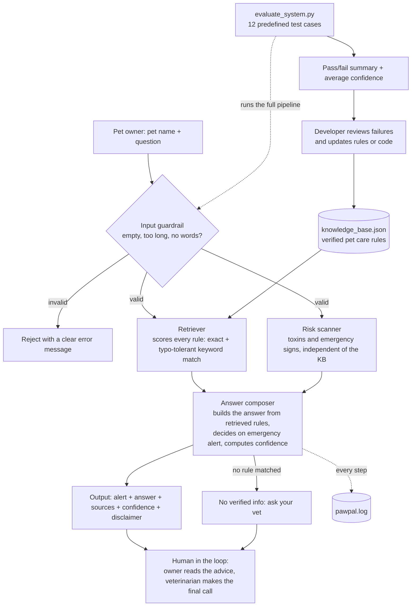

# PawPal+: Applied AI System

PawPal+ answers everyday pet care questions (feeding, exercise, vaccinations, toxic foods) using **retrieval-augmented generation over a verified knowledge base**, with **safety guardrails** that flag toxins and emergency symptoms and tell the owner to contact a vet. It matters because pet owners often search for quick answers in a panic, and a wrong or overconfident answer about something like chocolate or xylitol can be dangerous. PawPal+ only answers from rules it can cite, says how confident it is, and admits when it doesn't know.

## 1. Base Project

- **Base project:** PawPal+ (Module 2 mini-project)
- **Original goals and capabilities:** PawPal+ was a lightweight Python prototype that stored simple pet profiles (name, species, age) and printed basic feeding and exercise tips. Its tips were hardcoded strings, so it could not look anything up, react to what the owner actually asked, or check its input for safety issues.

**What this version adds:**
1. **RAG retrieval:** every question is scored against `knowledge_base.json`, and the answer is built from the matching rules, with their IDs cited as sources.
2. **Guardrails:** input validation, an independent toxin/emergency risk scanner, typo-tolerant matching, a "no verified info" refusal for out-of-scope questions, and a disclaimer on every answer.
3. **Confidence scoring and logging:** each answer gets a confidence score based on how well it matched, and every step is logged to `pawpal.log`.
4. **Reliability harness:** `evaluate_system.py` runs 12 predefined cases and checks the status, the alert, and which rules were (and were not) retrieved.

---

## 2. Architecture Overview



The source file is [`diagrams/architecture.mmd`](diagrams/architecture.mmd).

How a question flows through the system:
1. **Input guardrail** rejects an empty pet name, an empty or oversized question (over 500 characters), or a question with no words, before any other work happens.
2. **Retriever** splits the question into words and scores each rule in `knowledge_base.json` by keyword matches. Exact matches count 1.0; close misspellings (for example "chocolat") count 0.75. Only rules close to the best score are kept, so weak side matches are dropped.
3. **Risk scanner** looks for toxins and emergency words on its own list, so an alert still fires even if the knowledge base has no rule for it.
4. **Answer composer** writes the answer from the retrieved rules. An alert is raised if the risk scanner found something **or** a retrieved rule is a toxic-food or emergency rule, so retrieval directly changes the system's behavior. Confidence is the best match score divided by 2 (capped at 1.0); below 0.5 the answer says so. If nothing matched, the system says it has no verified information instead of guessing.
5. **Humans in the loop:** the owner reads the advice and the vet makes the final call; the developer reviews harness failures and updates the rules.

---

## 3. Setup Instructions

Requires Python 3.9 or newer. No third-party packages are needed.

```bash
# 1. Clone the repository
git clone https://github.com/Eyaisu1463/applied-ai-system-project.git
cd applied-ai-system-project

# 2. Create and activate a virtual environment
python -m venv .venv
# Windows PowerShell:
.\.venv\Scripts\Activate.ps1
# Mac/Linux:
# source .venv/bin/activate

# 3. Install dependencies (standard library only, so this installs nothing)
python -m pip install --upgrade pip
pip install -r requirements.txt

# 4. Run the demo questions
python pawpal_system.py

# 5. Ask your own question (add --trace to see each pipeline step)
python pawpal_system.py --pet Max --query "Can Max eat grapes?" --trace

# 6. Run the reliability harness
python evaluate_system.py
```

---

## 4. Sample Interactions

### Example 1: Demo run (RAG retrieval + emergency alert + routine answers)

```text
> python pawpal_system.py
No --pet/--query given, running demo questions.

PawPal+ answer for Max
Question: Can Max eat chocolate brownies?
[!] EMERGENCY ALERT: possible toxin or emergency sign detected. Contact your veterinarian or an animal poison control hotline now.
Answer:
  - Keep Max away from this. Chocolate contains theobromine, which is toxic to dogs and cats and can cause vomiting, a racing heart, tremors and seizures. Darker chocolate is more dangerous.
Sources: toxic-chocolate
Confidence: 1.00
Note: PawPal+ gives general information only and is not a substitute for a licensed veterinarian.

PawPal+ answer for Luna
Question: When should Luna get her booster shots?
Answer:
  - Adult pets need booster shots every 1 or 3 years, depending on the vaccine type and local law. Your vet will set the exact schedule.
Sources: vacc-booster
Confidence: 1.00
Note: PawPal+ gives general information only and is not a substitute for a licensed veterinarian.

PawPal+ answer for Bella
Question: How much should I walk my dog?
Answer:
  - Most adult dogs need 30 minutes to 2 hours of activity a day depending on breed, age and health. Puppies and senior dogs do better with shorter, gentler sessions.
Sources: exercise-dog
Confidence: 0.50
Note: PawPal+ gives general information only and is not a substitute for a licensed veterinarian.
```

### Example 2: Misspelled toxin, with the pipeline trace

The typo "chocolat" is still caught by the typo-tolerant matcher, and the lower confidence is reported honestly.

```text
> python pawpal_system.py --pet Rex --query "My dog ate chocolat" --trace
PawPal+ answer for Rex
Question: My dog ate chocolat
[!] EMERGENCY ALERT: possible toxin or emergency sign detected. Contact your veterinarian or an animal poison control hotline now.
Answer:
  - Keep Rex away from this. Chocolate contains theobromine, which is toxic to dogs and cats and can cause vomiting, a racing heart, tremors and seizures. Darker chocolate is more dangerous.
Low confidence: your question only partly matched my rules. Please rephrase or check with your vet.
Sources: toxic-chocolate
Confidence: 0.38
Note: PawPal+ gives general information only and is not a substitute for a licensed veterinarian.
Trace:
  input_guardrail: ok
  retrieve: toxic-chocolate (score 0.75)
  risk_scan: ['chocolate']
  compose: status=ok emergency=True confidence=0.38
```

### Example 3: Guardrails (invalid input and out-of-scope question)

```text
> python pawpal_system.py --pet "" --query "Is garlic safe?"
Error: Pet name cannot be empty.

> python pawpal_system.py --pet Milo --query "What is the capital of France?"
PawPal+ answer for Milo
Question: What is the capital of France?
Answer: I don't have verified information on that. Please ask your veterinarian.
Sources: none
Confidence: 0.00
Note: PawPal+ gives general information only and is not a substitute for a licensed veterinarian.
```

---

## 5. Reliability and Guardrail Results

```text
> python evaluate_system.py
--- Running PawPal+ Reliability Evaluation ---
Test  1: PASS                     Toxic food (chocolate)   emergency=True conf=1.00
Test  2: PASS                     Empty pet name           emergency=False conf=0.00
Test  3: PASS                     Empty query              emergency=False conf=0.00
Test  4: PASS                     Oversized query          emergency=False conf=0.00
Test  5: PASS                     Routine vaccination      emergency=False conf=1.00
Test  6: PASS                     Emergency symptoms       emergency=True conf=1.00
Test  7: PASS                     Misspelled toxin         emergency=True conf=0.38
Test  8: PASS                     Hidden toxin (xylitol)   emergency=True conf=1.00
Test  9: PASS                     Routine exercise         emergency=False conf=0.50
Test 10: PASS                     Cat play                 emergency=False conf=0.50
Test 11: PASS                     Out of scope             emergency=False conf=0.00
Test 12: FAIL (known limitation)  Breed name, not food     emergency=True conf=0.50
           -> emergency True != False

Evaluation Summary: 11/12 tests passed (0 unexpected failure(s)).
Average confidence on answered questions: 0.73
```

Each case checks more than "did it run": the expected status, whether the emergency alert fired, which rules must be retrieved, and which must **not** be (for example, the chocolate question must not also return the grapes rule).

---

## 6. Design Decisions and Trade-offs

| Decision | Why | Trade-off |
|---|---|---|
| Local JSON knowledge base instead of a live LLM | Every answer comes from a rule I can check and cite, so the system can't invent medical advice | It only knows what's in the file; anything else gets "ask your vet" |
| Keyword scoring with typo tolerance (`difflib`) | Simple, explainable and needs no packages; catches common misspellings like "chocolat" | Doesn't understand meaning, so "chocolate lab" (a dog breed) still triggers the chocolate alert |
| Two independent alert paths (risk scanner + retrieved rule category) | If one path misses, the other can still raise the alert; for safety, a false alarm is better than a missed one | More false positives |
| Confidence from match strength, not a fixed number | The score actually means something: 1.00 = two or more exact matches, 0.38 = one fuzzy match | It measures how well the question matched, not whether the advice is medically right |
| Refuse out-of-scope questions | Saying "I don't know" is safer than returning an unrelated rule | Less helpful for questions the knowledge base doesn't cover |
| Standard library only | Anyone can run it with no install problems | No semantic search |

---

## 7. Testing Summary

- **What worked:** 11 of 12 harness cases pass, including empty and oversized input, a misspelled toxin, a hidden toxin (xylitol in sugar-free gum), and an out-of-scope question. Average confidence on answered questions is 0.73.
- **What didn't:** "My chocolate lab needs more exercise" raises a false emergency alert, because the system matches the word "chocolate" without understanding it's a breed. I kept this as a documented known-limitation test instead of hiding it.
- **Bugs that testing found and I fixed:** the first version matched short words like "can" inside other words, so a chocolate question also returned the grapes rule. Unmatched questions fell back to the emergency rule, which was misleading. A misspelled "chocolat" got no alert at all. The confidence score was hardcoded. The original 4-test harness only checked "PASS/FAIL" status, so it passed 4/4 while all of these bugs were present.
- **What I learned:** a test suite that only checks whether the code runs gives false confidence. Tests need to check the actual behavior that matters, like whether the alert fired and which sources were used.

---

## 8. Reflection

This project taught me that a reliable AI system is mostly about what happens around the answer: checking the input, grounding the answer in sources, measuring confidence honestly, and admitting when the system doesn't know. My original tests all passed while the system was returning wrong rules, which showed me that "it works" has to be proven with tests that check real behavior.

*(The responsible-AI reflection, including AI collaboration, limitations and misuse, is in [`model_card.md`](model_card.md).)*

---

## 9. Portfolio

- **GitHub repository:** https://github.com/Eyaisu1463/applied-ai-system-project

### What this project says about me as an AI engineer
Building PawPal+ was a great way for me to take a basic Python script and turn it into a real, dependable AI system. Instead of just letting the model guess answers, I built a local RAG engine that pulls verified facts, added input guardrails to catch bad data, and created safety checks for dangerous pet foods. I also wrote an automated test harness that checks real behavior, not just whether the code runs, and I documented the one case it still gets wrong. This project really showed me that good AI engineering isn't just about getting cool responses—it's about making sure your system is safe, reliable, and actually tested.
